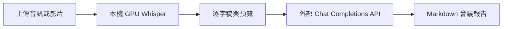

# 會議記錄整理工具

本專案採用混合流程：音訊／影片在本機用 GPU Whisper 轉錄，會議報告則使用外部 OpenAI-compatible Chat Completions API。預設外部 LLM 為 Google AI Studio 的 Gemini；本機不再使用 Ollama。

## 流程



## 環境需求

- Docker Engine、Docker Compose v2、NVIDIA driver、NVIDIA Container Toolkit。
- GPU Whisper 會自動選擇模型；RTX 4070 Ti 12 GB 預設使用 `medium/cuda/float16`。
- 一個支援 `POST /chat/completions` 的外部 API。Google AI Studio 的 Gemini OpenAI-compatible endpoint 已可直接使用。 [Google Gemini OpenAI compatibility](https://ai.google.dev/gemini-api/docs/openai)

## Google AI Studio 設定

1. 在 [Google AI Studio API Keys](https://aistudio.google.com/app/apikey) 建立或取得 Gemini API key。
2. 複製 `.env.example` 成 `.env`。
3. 填入 `MEETING_CHAT_API_KEY`，保留其餘 Google 預設值。

```bash
cp .env.example .env
```

```dotenv
MEETING_CHAT_API_BASE_URL=https://generativelanguage.googleapis.com/v1beta/openai
MEETING_CHAT_API_KEY=replace-with-your-gemini-key
MEETING_CHAT_MODEL=gemini-3.5-flash

WHISPER_MODEL=medium
WHISPER_DEVICE=cuda
WHISPER_COMPUTE_TYPE=float16
```

Gemini API key 應限制為 Gemini API；Google 已公告新的 AI Studio key 預設為 auth key，且會逐步停止接受未受限制的 standard key。 [Google Gemini API key guidance](https://ai.google.dev/gemini-api/docs/api-key)

## 其他外部 LLM 供應商

只要供應商支援 OpenAI-compatible Chat Completions，就覆寫下列三個欄位：

| 欄位 | 用途 | Google AI Studio 預設 |
|---|---|---|
| `MEETING_CHAT_API_BASE_URL` | API base URL，不含 `/chat/completions` | `https://generativelanguage.googleapis.com/v1beta/openai` |
| `MEETING_CHAT_API_KEY` | API key，不寫入 Git | Gemini API key |
| `MEETING_CHAT_MODEL` | 報告生成模型 | `gemini-3.5-flash` |

例如使用另一個相容服務時，設定其 endpoint、key 和 model 即可。轉錄不受這三個欄位影響，始終使用本機 Whisper。

## 啟動與驗證

```bash
docker compose build meeting-app
docker compose up -d --force-recreate meeting-app
curl http://localhost:8001/api/health
```

健康狀態會同時顯示外部 LLM readiness 與 Whisper 的 model/device。確認 GPU runtime：

```bash
docker compose exec meeting-app nvidia-smi
docker compose exec meeting-app python3 -c \
  "import ctranslate2; print(ctranslate2.get_cuda_device_count())"
```

瀏覽器入口：

```text
http://localhost:8001
```

## 資料與隱私

- 上傳音訊及影片會留在本機 `data/uploads/`，由本機 Whisper 轉錄。
- 逐字稿會傳送至外部 LLM 以整理成報告；請確認該供應商的資料政策適合會議內容。
- API key 只由 `.env` 傳入 container，不會出現在 health response、job response 或 Git。

## 測試

```bash
docker compose run --rm --no-deps meeting-app \
  python3 -m unittest discover -s tests -v
docker compose config --quiet
```

測試會 mock Whisper 與 HTTP，不會下載 Whisper 模型、不會發送真實 API 請求或產生費用。

## 已知限制

- job 狀態保存在記憶體；容器重啟後保留輸出檔，但不會恢復進行中的工作。
- 報告內容由外部 LLM 產生，責任人、期限與決議仍需人工覆核。
- 初次使用某個 Whisper model 時會下載至 Docker volume，之後會重用快取。

## 資訊來源 / 參考資料

- 本地：[本機 Whisper 與外部 LLM adapter](/home/robertlo/Desktop/personal/Tool/meeting/app/meeting_service.py)。
- 本地：[硬體與模型選擇](/home/robertlo/Desktop/personal/Tool/meeting/app/model_selector.py)。
- 本地：[Docker GPU 與環境變數設定](/home/robertlo/Desktop/personal/Tool/meeting/docker-compose.yml)。
- Google 官方：[OpenAI compatibility](https://ai.google.dev/gemini-api/docs/openai)，用途：Gemini Chat Completions endpoint、Bearer 認證與 model 設定；存取日期：2026-07-11。
- Google 官方：[Using Gemini API keys](https://ai.google.dev/gemini-api/docs/api-key)，用途：key 建立與限制；存取日期：2026-07-11。
