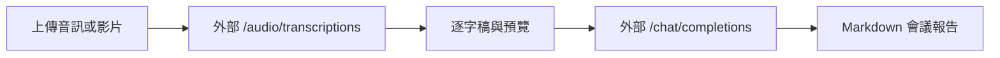

# 外部 API 會議記錄整理工具

本專案將音訊或影片交給外部 OpenAI-compatible API 轉錄與整理，不會在本機或 Docker 容器內載入 Whisper、Ollama 或其他 LLM 模型。完成後輸出 Markdown 逐字稿與會議報告。

## 流程



容器只負責檔案保存、API 呼叫、預覽與報告下載；不再需要 NVIDIA GPU、NVIDIA Container Toolkit、Ollama container 或本機模型快取。

## 環境需求

- Docker Engine 與 Docker Compose v2。
- 可用的外部 OpenAI-compatible API，且同時支援：
  - `POST /v1/audio/transcriptions`
  - `POST /v1/chat/completions`
  - 建議支援 `GET /v1/models`，供 health check 驗證模型。
- API key 與已啟用的 transcription、chat 模型。

預設使用 OpenAI endpoint、`gpt-4o-mini-transcribe` 與 `gpt-4o-mini`；可透過環境變數改為其他相容供應商或模型。OpenAI 官方文件列出前者為語音轉文字模型，後者支援 Chat Completions。 [GPT-4o mini Transcribe](https://developers.openai.com/api/docs/models/gpt-4o-mini-transcribe) [GPT-4o mini](https://developers.openai.com/api/docs/models/gpt-4o-mini)

## 設定

複製範例並填入真實 key；`.env` 已被 Git 忽略。

```bash
cp .env.example .env
```

必要設定：

```dotenv
EXTERNAL_API_BASE_URL=https://api.openai.com/v1
EXTERNAL_API_KEY=replace-with-your-secret
EXTERNAL_LLM_MODEL=gpt-4o-mini
EXTERNAL_TRANSCRIPTION_MODEL=gpt-4o-mini-transcribe
EXTERNAL_TRANSCRIPTION_RESPONSE_FORMAT=verbose_json
```

不要將 API key 放入 `docker-compose.yml`、程式碼或 Git。若供應商不支援 `verbose_json`，請依其文件調整 `EXTERNAL_TRANSCRIPTION_RESPONSE_FORMAT`；若不回傳 segments，系統仍會保存完整逐字稿，但沒有時間戳區段。

`MAX_UPLOAD_MB` 預設為 25，避免超過常見外部 transcription API 的媒體限制；僅在供應商明確支援時才提高。

## 啟動與驗證

```bash
docker compose build meeting-app
docker compose up -d meeting-app
curl http://localhost:8001/api/health
```

健康狀態應包含：

```json
{
  "status": "ok",
  "external_api": {
    "available": true
  }
}
```

若 key 缺失、endpoint 無法連線或模型不存在，健康狀態為 `not_ready`，前端會顯示原因；建立工作時會拒絕或標記失敗，不會改用本地模型。

瀏覽器入口：

```text
http://localhost:8001
```

## API

### 健康狀態

```http
GET /api/health
```

回傳外部 endpoint、設定的 transcription/chat 模型，以及不含秘密的連線狀態。

### 建立工作

```http
POST /api/jobs
Content-Type: multipart/form-data
```

欄位：`file`、`meeting_title`、`language`、`output_language`、`report_mode`。處理中的 job 可透過 `GET /api/jobs/{job_id}` 查詢逐字稿與報告預覽；完成後可下載 report 和 transcript。

## 資料與隱私

- 原始上傳檔存於 `data/uploads/`。
- 逐字稿與報告存於 `data/reports/`。
- 音訊、影片、逐字稿會傳送到設定的外部 API；請確認供應商的資料處理與保留政策適合會議內容。
- API key 僅以 container environment 傳遞，不會出現在 health response、job response 或 log。

## 驗證

```bash
docker compose run --rm --no-deps meeting-app \
  python -m unittest discover -s tests -v
docker compose config --quiet
```

測試會 mock 外部 HTTP，不會發出真實 API 請求或產生費用。

## 已知限制

- 目前 job 狀態保存在記憶體；容器重啟後保留產出檔案，但不會恢復進行中的工作。
- 長逐字稿會先分段摘要再交由外部 API 合併，可能損失少量上下文。
- 自動整理的責任人、期限與決議仍需人工覆核。

## 資訊來源 / 參考資料

- 本地：[外部 API adapter](/home/robertlo/Desktop/personal/Tool/meeting/app/meeting_service.py)，用途：transcription 與 Chat Completions 呼叫。
- 本地：[外部模型設定](/home/robertlo/Desktop/personal/Tool/meeting/app/model_selector.py)，用途：endpoint、model 與 key 環境變數驗證。
- 本地：[Docker 設定](/home/robertlo/Desktop/personal/Tool/meeting/docker-compose.yml)，用途：移除本地 Ollama／GPU 服務。
- OpenAI 官方：[Speech to text](https://developers.openai.com/api/docs/guides/speech-to-text)，用途：外部 transcription API 介面；存取日期：2026-07-11。
- OpenAI 官方：[GPT-4o mini Transcribe](https://developers.openai.com/api/docs/models/gpt-4o-mini-transcribe)，用途：預設轉錄模型；存取日期：2026-07-11。
- OpenAI 官方：[GPT-4o mini](https://developers.openai.com/api/docs/models/gpt-4o-mini)，用途：預設 Chat Completions 模型；存取日期：2026-07-11。
