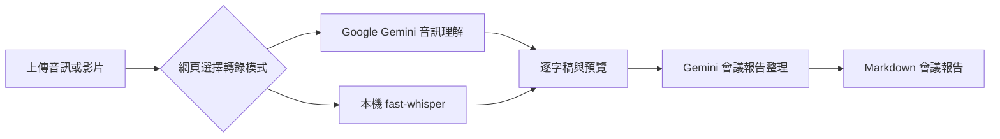

# 會議記錄整理工具

本專案預設使用本機 fast-whisper 轉錄，並可在網頁切換成 Google Gemini API 轉錄。會議報告整理固定使用 Google Gemini API 產生 Markdown 報告。

## 流程



## 環境需求

- Docker Engine 與 Docker Compose v2。
- Google AI Studio / Gemini API key。
- 本機 fast-whisper 模式預設使用 CPU：`WHISPER_MODEL=base`、`WHISPER_DEVICE=cpu`、`WHISPER_COMPUTE_TYPE=int8`。
- 不需要 Ollama。若要改用 GPU fast-whisper，需另外確認 Docker GPU runtime 與 CUDA 相容設定。

## Google AI Studio 設定

1. 到 [Google AI Studio API Keys](https://aistudio.google.com/app/apikey) 建立或取得 Gemini API key。
2. 複製 `.env.example` 成 `.env`，或沿用既有 `.env`。
3. 建議設定 `GEMINI_API_KEY`；若目前只有舊的 `EXTERNAL_API_KEY`，`docker-compose.yml` 仍會把它映射成容器內的 `GEMINI_API_KEY`。

```bash
cp .env.example .env
```

```dotenv
GEMINI_API_KEY=replace-with-your-gemini-key
GOOGLE_API_BASE_URL=https://generativelanguage.googleapis.com/v1beta
GOOGLE_TRANSCRIPTION_MODEL=gemini-3.1-flash-lite
GOOGLE_LLM_MODEL=gemini-3.1-flash-lite
WHISPER_MODEL=base
WHISPER_DEVICE=cpu
WHISPER_COMPUTE_TYPE=int8
```

## 啟動與驗證

```bash
docker compose build meeting-app
docker compose up -d --force-recreate meeting-app
curl http://localhost:8001/api/health
```

瀏覽器入口：

```text
http://localhost:8001
```

健康狀態會顯示 Google API base URL、Gemini 轉錄模型、報告模型、本機 fast-whisper model/device/compute type，以及 Google `/models` 檢查結果。預設轉錄模式是本機 fast-whisper，模型使用 `base/cpu/int8`；Gemini 轉錄備用模型是 `gemini-3.1-flash-lite`。

## 資料與隱私

- 上傳檔案會暫存在本機 `data/uploads/`。
- 若選 Google Gemini API 轉錄，音訊／影片內容會送到 Google Gemini API。
- 若選本機 fast-whisper 轉錄，音訊／影片內容留在容器內本機轉錄；首次使用模型會下載到 Docker volume `whisper-cache`。
- 逐字稿會再送到 Google Gemini API 產生報告。
- API key 只由 `.env` 傳入 container，不會出現在 health response、job response 或 Git。

## 測試

```bash
docker compose run --rm --no-deps meeting-app \
  python -m unittest discover -s tests -v
docker compose config --quiet
```

測試會 mock Google SDK、HTTP 與 fast-whisper，不會下載 Whisper 模型、不會發送真實 API 請求或產生費用。

## 已知限制

- Gemini 轉錄是音訊理解能力，不是專用 Google Cloud Speech-to-Text；若要即時轉錄或更細緻的 speech-to-text contract，需改接 Google Cloud Speech-to-Text。
- 本機 fast-whisper 預設 CPU 模式較慢；長錄音建議使用 Gemini 轉錄或另外配置 GPU runtime。
- job 狀態保存在記憶體；容器重啟後保留輸出檔，但不會恢復進行中的工作。
- AI 自動轉錄與整理可能誤判講者、期限與專有名詞；正式發布前需人工覆核。

## 資訊來源 / 參考資料

- 本地：`/home/robertlo/Desktop/personal/Tool/meeting/app/meeting_service.py`，用途：Google Gemini Files API、`models.generate_content`、本機 fast-whisper 轉錄與報告生成流程。
- 本地：`/home/robertlo/Desktop/personal/Tool/meeting/app/model_selector.py`，用途：Google API key、Gemini 模型與 fast-whisper 模型設定。
- 本地：`/home/robertlo/Desktop/personal/Tool/meeting/docker-compose.yml`，用途：Docker 環境變數、Google API 與 fast-whisper cache 設定。
- Google 官方：[Audio understanding](https://ai.google.dev/gemini-api/docs/audio)，用途：音訊上傳、音訊理解、逐字稿 prompt 與 structured output；存取日期：2026-07-11。
- Google 官方：[Text generation](https://ai.google.dev/gemini-api/docs/text-generation)，用途：Gemini 文字生成、system instruction 與 generation config；存取日期：2026-07-11。
- Google 官方：[Get started](https://ai.google.dev/gemini-api/docs/get-started)，用途：API key 建立與認證設定；存取日期：2026-07-11。
